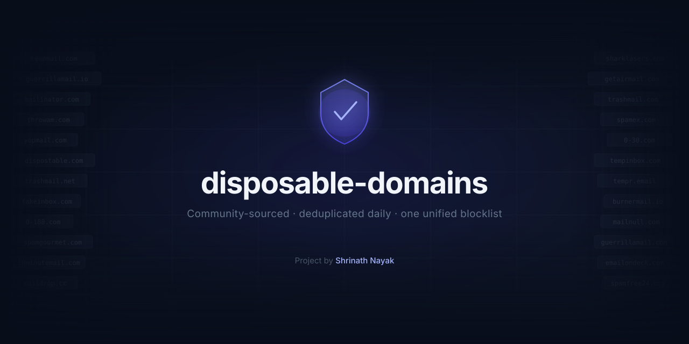

# disposable-domains

<p align="center">
  
</p>

**One unified blocklist of disposable email domains - merged from 34 community sources, deduplicated, and rebuilt every day.**

[🚀 Usage](#usage) · [📰 Changes](CHANGES.md) · [📄 Output format](#output-format) · [🌐 Sources](#sources) · [🤝 Contributing](#contributing) · [🛠 Local dev](#local-development)

---

## 📊 Stats

<!-- STATS_START -->
| Metric | Value |
|--------|-------|
| Disposable Domains | 322,875 |
| Strict list (2+ sources) | 279,119 |
| Sources | 34 |
| Generated on | Mon, 23 Nov 2026 19:41:48 GMT |
<!-- STATS_END -->

---

## 📰 Latest changes

<!-- CHANGES_START -->
| Run | Added | Removed | Total |
| --- | ---: | ---: | ---: |
| 2026-11-23 19:41 UTC | +2 | 0 | 322,875 |
| 2026-11-23 19:06 UTC | +12,282 | −156 | 322,873 |

[See the full change report →](CHANGES.md)
<!-- CHANGES_END -->

---

## 🛡 Why this exists

Every disposable email blocklist has blind spots. This repo pulls from **34 community-maintained lists**, merges them into a single sorted `domains.json`, and pushes an update every day at 02:00 UTC - so you get broader coverage without managing multiple upstreams yourself.

---

## 🚀 Usage

Grab the raw file and check against it in any language:

```
https://cdn.jsdelivr.net/gh/shrinathsnayak/disposable-domains/domains.json
```

### TypeScript / JavaScript

```ts
const { domains } = await fetch(
  "https://cdn.jsdelivr.net/gh/shrinathsnayak/disposable-domains/domains.json",
).then((r) => r.json());

const blocked = new Set<string>(domains);

function isDisposable(email: string): boolean {
  return blocked.has(email.split("@")[1]?.toLowerCase() ?? "");
}
```

### Python

```python
import urllib.request, json

with urllib.request.urlopen(
  "https://cdn.jsdelivr.net/gh/shrinathsnayak/disposable-domains/domains.json"
) as res:
    data = json.load(res)

blocked = set(data["domains"])

def is_disposable(email: str) -> bool:
    parts = email.lower().rsplit("@", 1)
    return len(parts) == 2 and parts[1] in blocked
```

### 🎯 Strict list (fewer false positives)

The full list includes every domain that **any** source flags, so one mistaken upstream can block a real provider. If wrongly blocking a signup costs you more than letting a throwaway address through, use the strict list. It keeps only domains that at least **two different projects** list, plus the manually blocked ones:

```
https://cdn.jsdelivr.net/gh/shrinathsnayak/disposable-domains/domains-strict.txt
```

It is plain text, one domain per line, so it drops into the snippets above as `new Set(text.trim().split("\n"))`. Variants of one project, such as `7c/fakefilter` and `7c/fakefilter (JSON v2)`, count as one source. Many upstream lists copy from each other, so two sources agreeing means the domain is less likely to be a one-off mistake, not that it was checked independently.

### 🔍 Inspect metadata with curl

```bash
curl -s https://cdn.jsdelivr.net/gh/shrinathsnayak/disposable-domains/domains.json \
  | jq '.meta'
```

---

## 📄 Output format

`domains.json` has two top-level keys - `meta` for auditing and `domains` for lookups:

```json
{
  "meta": {
    "generated_on": "2026-04-10T02:00:00.000Z",
    "total": 196394,
    "strict_total": 169842,
    "source_count": 31,
    "sources": [
      {
        "name": "ivolo/disposable-email-domains",
        "url": "...",
        "raw_count": 121557,
        "status": "ok"
      }
    ]
  },
  "domains": ["0-180.com", "0-30.com", "..."]
}
```

The `meta.sources` array records the per-source domain count and fetch status, making it easy to spot a broken upstream at a glance. `meta.strict_total` is the size of `domains-strict.txt`.

`domains.txt` holds the same domains as `domains.json`, one per line. `domains-strict.txt` is the [strict list](#-strict-list-fewer-false-positives) in the same format.

---

## ⚙️ How it works

Every day at **02:00 UTC**, the GitHub Actions workflow:

1. Fetches all 34 upstream blocklists **concurrently** (capped at 8 in-flight to avoid rate-limiting)
2. Merges the domains and counts, for each one, how many different projects list it (variants of one project count once)
3. Merges any entries from `MANUAL_BLOCKED_DOMAINS` in [`blocked-sources.ts`](src/blocked-sources.ts) (trimmed, lowercased; invalid hostnames are skipped)
4. Filters out legitimate providers via `ALLOWED_DOMAINS` and optional allowlist sources (`ALLOWLIST_SOURCES` in [`allowed-sources.ts`](src/allowed-sources.ts)) - same `name` / `url` / `format` shape as blocklists. `ALLOWED_DOMAINS` ships with ~150 major webmail providers and ISPs (Gmail, Outlook, iCloud, Proton, GMX, Mail.ru, QQ, Comcast, …) that some upstream lists mislabel as disposable
5. Drops domains whose TLD is not in the [IANA root zone](https://data.iana.org/TLD/tlds-alpha-by-domain.txt) (typos like `gmail.con`, IP addresses, scraped junk). If the IANA list can't be fetched, this step is skipped rather than failing the run
6. Refuses to publish if the run looks like a broken or poisoned upstream: the total drops by more than 5%, or a single source grows by more than 50% (and at least 1,000 domains) since the previous run. The job fails and nothing is written; after reviewing, re-run it from the Actions tab with **allow_large_changes** checked (or set `ALLOW_LARGE_CHANGES=1` locally)
7. Writes a single sorted `domains.json` with full source stats, the same list as `domains.txt`, and `domains-strict.txt` with only the domains that two or more projects list (plus manual blocks)
8. Compares the result with the previous run and, if anything changed, adds an entry to [`CHANGES.md`](CHANGES.md) (how many domains were added and removed; last 30 runs kept) and refreshes the **Latest changes** preview above
9. Commits the result **only if the content actually changed**

You can also trigger a manual run any time from the Actions tab via `workflow_dispatch`.

---

## 🌐 Sources

34 community lists, merged into one:

| Source                                                                                                                    | Format             |
| ------------------------------------------------------------------------------------------------------------------------- | ------------------ |
| [disposable-email-domains/disposable-email-domains](https://github.com/disposable-email-domains/disposable-email-domains) | lines              |
| [di/martenson-disposable-email-domains](https://github.com/di/martenson-disposable-email-domains)                         | lines              |
| [disposable/disposable-email-domains (TXT)](https://disposable.github.io/disposable-email-domains/domains.txt)            | lines              |
| [disposable/disposable-email-domains (MX-verified)](https://disposable.github.io/disposable-email-domains/domains_mx.txt) | lines              |
| [ivolo/disposable-email-domains](https://github.com/ivolo/disposable-email-domains)                                       | json_array         |
| [wesbos/burner-email-providers](https://github.com/wesbos/burner-email-providers)                                         | lines              |
| [FGRibreau/mailchecker](https://github.com/FGRibreau/mailchecker)                                                         | lines              |
| [flotwig/disposable-email-addresses](https://github.com/flotwig/disposable-email-addresses)                               | lines              |
| [daisy1754/jp-disposable-emails](https://github.com/daisy1754/jp-disposable-emails)                                       | lines              |
| [unkn0w/disposable-email-domain-list](https://github.com/unkn0w/disposable-email-domain-list)                             | lines              |
| [amieiro/disposable-email-domains](https://github.com/amieiro/disposable-email-domains)                                   | lines              |
| [stopforumspam/toxic_domains](https://www.stopforumspam.com)                                                              | lines              |
| [MattKetmo/EmailChecker](https://github.com/MattKetmo/EmailChecker)                                                       | lines              |
| [adamloving/disposable-email-domains](https://gist.github.com/adamloving/4401361)                                         | lines              |
| [jamesonev/disposable-email-domains](https://gist.github.com/jamesonev/7e188c35fd5ca754c970e3a1caf045ef)                  | lines              |
| [elliotjreed/disposable-emails-filter-php](https://github.com/elliotjreed/disposable-emails-filter-php)                   | lines              |
| [disposable/static-disposable-lists (mail-data-hosts-net)](https://github.com/disposable/static-disposable-lists)         | lines              |
| [disposable/static-disposable-lists (manual)](https://github.com/disposable/static-disposable-lists)                      | lines              |
| [7c/fakefilter](https://github.com/7c/fakefilter)                                                                         | lines              |
| [7c/fakefilter (JSON v2)](https://github.com/7c/fakefilter/blob/main/json/data_version2.json)                             | json_fakefilter_v2 |
| [GeroldSetz/emailondeck.com-domains](https://github.com/GeroldSetz/emailondeck.com-domains)                               | lines              |
| [groundcat/disposable-email-domain-list](https://github.com/groundcat/disposable-email-domain-list)                       | lines              |
| [romainsimon/emailvalid](https://github.com/romainsimon/emailvalid)                                                       | json_object_keys   |
| [andreis/disposable-email-domains](https://github.com/andreis/disposable-email-domains)                                   | lines              |
| [TheDahoom/disposable-email](https://github.com/TheDahoom/disposable-email)                                               | lines              |
| [eser/sanitizer-svc](https://github.com/eser/sanitizer-svc)                                                               | lines              |
| [kslr/disposable-email-domains](https://github.com/kslr/disposable-email-domains)                                         | lines              |
| [sublime-security/static-files](https://github.com/sublime-security/static-files)                                         | lines              |
| [doodad-labs/disposable-email-domains](https://github.com/doodad-labs/disposable-email-domains)                           | lines              |
| [Propaganistas/Laravel-Disposable-Email](https://github.com/Propaganistas/Laravel-Disposable-Email)                       | json_array         |
| [DeviceAndBrowserInfo](https://deviceandbrowserinfo.com/) (disposable email API)                                          | json_array         |
| [infiniteloopltd/TempEmailDomainMXRecords](https://github.com/infiniteloopltd/TempEmailDomainMXRecords)                   | csv                |
| [tompec/disposable-email-domains](https://github.com/tompec/disposable-email-domains)                                     | json_array         |
| [TempMailDetector/Temporary-Email-Domain-Blocklist](https://github.com/TempMailDetector/Temporary-Email-Domain-Blocklist) | lines              |

---

## 🤝 Contributing

### ➕ Adding a source

1. Add an entry to `BLOCKED_SOURCES` in [`src/blocked-sources.ts`](src/blocked-sources.ts):

```ts
{
  name: "owner/repo-name",
  url: "https://raw.githubusercontent.com/owner/repo/main/domains.txt",
  format: "lines", // "lines" | "json_array" | "json_object" | "json_object_keys" | "csv" | "json_fakefilter_v2"
}
```

2. Supported formats:

| Format               | Description                                                                                       |
| -------------------- | ------------------------------------------------------------------------------------------------- |
| `lines`              | One domain per line - `#`, `//`, and `;` comment prefixes are stripped                            |
| `json_array`         | Top-level JSON array of domain strings                                                            |
| `json_object`        | JSON object with a named array of domains (use `key` / optional `subkey`)                         |
| `json_object_keys`   | JSON object where domain names are the keys                                                       |
| `csv`                | CSV with a header row; set `csv_domain_column` to the domain column name (default `domain`)       |
| `json_fakefilter_v2` | [7c/fakefilter](https://github.com/7c/fakefilter) `data_version2.json` (`domains` + `hosts` keys) |

3. If the new feed is another variant of a project that is already listed, give it the same name with a suffix in parentheses, such as `"owner/repo (MX-verified)"`. The strict list treats names that differ only by that suffix as one source, so a project can't confirm its own domains.

4. Run `npm run generate` locally to confirm the source resolves correctly, then open a PR.

### ✅ Whitelisting a domain

To prevent a domain from ever appearing in the output, add it to `ALLOWED_DOMAINS` in [`src/allowed-sources.ts`](src/allowed-sources.ts) (keep the list sorted):

```ts
export const ALLOWED_DOMAINS: string[] = [
  // …
  "example.com",
  // …
];
```

This is merged with domains from every entry in `ALLOWLIST_SOURCES` at generation time (each uses the same formats as blocklists).

To pull an allowlist from upstream with a non-text format, add objects to `ALLOWLIST_SOURCES` in the same way as blocklist entries (see **Adding a source** above).

### ➕ Manually blocking domains

To always include domains in the output blocklist (for example a new disposable host not yet on upstream lists), add them to `MANUAL_BLOCKED_DOMAINS` in [`src/blocked-sources.ts`](src/blocked-sources.ts):

```ts
export const MANUAL_BLOCKED_DOMAINS: string[] = ["new-temp-host.example"];
```

They are merged after all upstream blocklists. If a domain is also listed in `ALLOWED_DOMAINS` or returned by `ALLOWLIST_SOURCES`, it is still removed from the final output.

---

## 📁 Project structure

```
disposable-domains/
├── src/
│   ├── blocked-sources.ts   `BLOCKED_SOURCES` + optional `MANUAL_BLOCKED_DOMAINS`
│   ├── allowed-sources.ts   optional `ALLOWLIST_SOURCES` + `ALLOWED_DOMAINS`
│   ├── constants.ts         output path, concurrency limit, domain regex
│   ├── logger.ts            winston logger (timestamp + colorized level)
│   ├── types.ts             TypeScript interfaces (Source, SourceStat)
│   ├── utils.ts             fetch, parse, and concurrency helpers
│   ├── changes.ts           daily change report + README preview rendering
│   └── generate.ts          orchestration entry point
├── test/
│   └── utils.test.ts        unit tests for parse helpers
├── .github/workflows/
│   ├── generate.yml         daily cron - regenerates and commits domains.json
│   └── test.yml             runs on every PR
├── domains.json
├── domains.txt              same list, one domain per line
├── domains-strict.txt       domains listed by 2+ projects
├── CHANGES.md               daily change report (generated)
└── README.md
```

---

## 🛠 Local development

Requires **Node 22+**.

```bash
npm install

npm run generate   # regenerate domains.json
npm test           # run unit tests
npm run build      # compile to dist/
```

---

## 📜 License

MIT - see [LICENSE](LICENSE).

---

Project by [Shrinath Nayak](https://snayak.dev)
